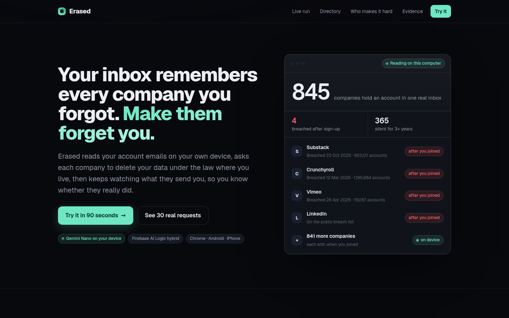
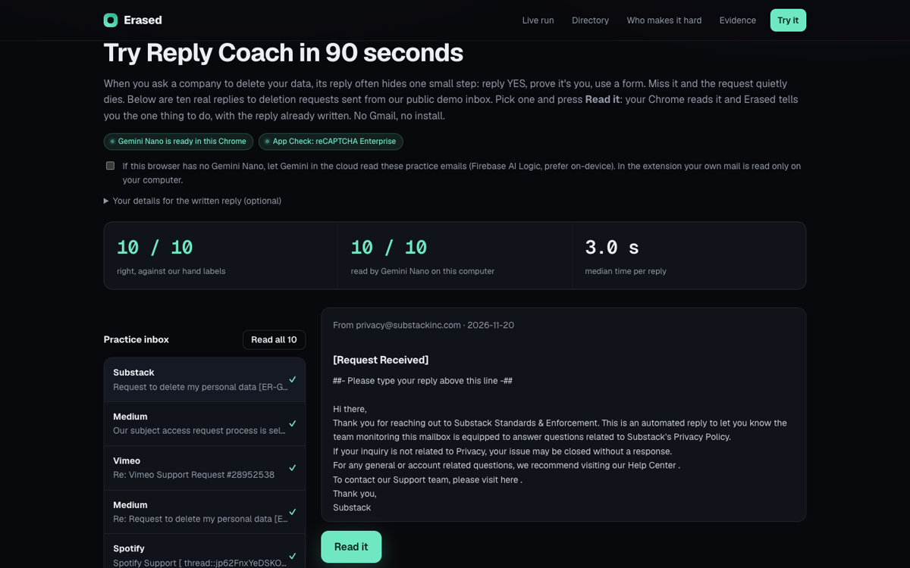
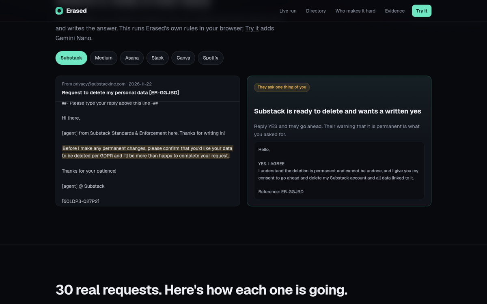
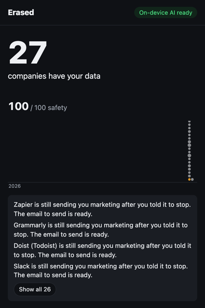
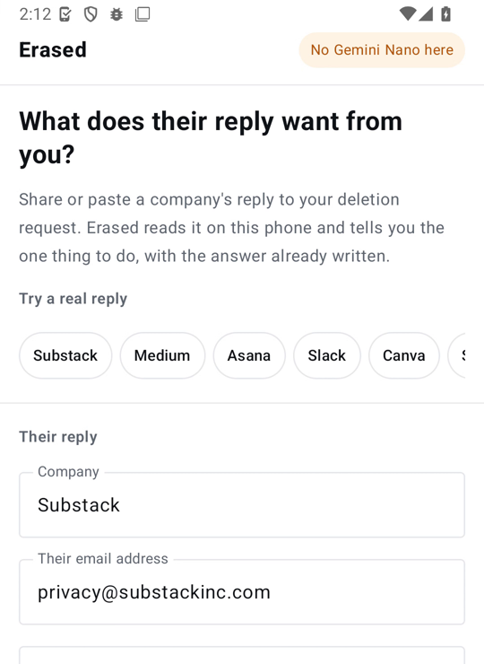
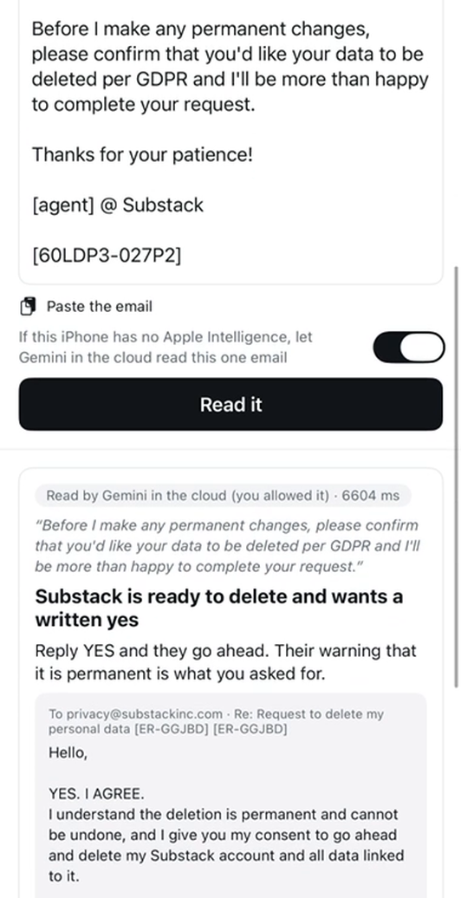

# Erased

**Make every company you forgot forget you, and prove they did.**

**Live:** [forget-me-hybrid.web.app](https://forget-me-hybrid.web.app) ·
**Try it in 90 s:** [/judge](https://forget-me-hybrid.web.app/judge) ·
**Live run:** [/run](https://forget-me-hybrid.web.app/run) ·
**Evidence:** [/evidence](https://forget-me-hybrid.web.app/evidence) ·
**Downloads:** [Chrome extension](https://github.com/Jennycruzy/erased/releases/latest/download/erased-extension.zip),
[Android APK](https://github.com/Jennycruzy/erased/releases/latest/download/erased-android.apk)
([SHA-256](https://github.com/Jennycruzy/erased/releases/latest/download/SHA256SUMS.txt)), iPhone: [build it](#iphone)

Built with [Firebase AI Logic](https://firebase.google.com/docs/ai-logic) hybrid inference: Gemini Nano in Chrome
and on Android, Apple's on-device model on iPhone, and Gemini in the cloud only for public pages, or for one email
when you allow it.

## The problem

Every sign-up leaves a copy of you behind. One real inbox (the maker's, 8,771 emails, counted on the device from
headers only on 19 Nov 2026) holds account emails from **845 companies**; **365** have not written in three years,
and **4** were breached *after* the sign-up (Substack, LinkedIn, Crunchyroll, Vimeo). The public
[Have I Been Pwned](https://haveibeenpwned.com/) catalogue lists **1,052 breaches and 17.9 billion breached
accounts**.

The law already says you can make them delete it: GDPR and UK GDPR Art 17, California's CCPA, Canada's PIPEDA,
Nigeria's NDPA s.34. Almost nobody uses it. In 2025, 32 European data protection authorities reviewed how 764
organisations handle erasure, and found that "the majority of the enquired controllers had not received a single
request for erasure in the last two years"; where people do ask, it often ends with the regulator: at the Dutch and
Luxembourg authorities, erasure "requests account for around 19% of the total number of complaints received"
([EDPB, Feb 2026](https://www.edpb.europa.eu/system/files/2026-02/edpb_cef-report_2025_right-to-erasure_en.pdf), pp. 11 and 24). Three things stop people:

1. **You don't know who has your data.** Nobody remembers 845 sign-ups, and tools that find them for you usually
   want your whole inbox on their servers.
2. **The request stalls.** When we sent 30 real requests, **19 of the 27 companies that answered asked for one
   more step first**: sign in yourself, use our form, click a link, prove it's you, reply YES. Miss it and nothing
   happens.
3. **Nobody checks.** **7 of the 30 companies kept sending marketing or sign-up nudges after the request**
   (Codecademy, Grammarly, monday.com, Skillshare, Slack, Todoist, Zapier). "Deleted" is a promise you can't see.

## How Erased fixes it

| Step | What Erased does | Where it runs |
|---|---|---|
| **Find** | Reads welcome, verify, password-reset and receipt emails in Gmail and lists every company you hold an account with, and when you joined. | **Gemini Nano on your computer** (`ONLY_ON_DEVICE`). Your mail never leaves it. |
| **Flag** | Matches each company against the breach catalogue: red if it was breached after you joined, grey if it has been silent for 3+ years. | On your computer (bundled catalogue). |
| **Ask** | Writes the legal deletion (or stop-marketing) letter for the law where you live (for GDPR countries in Spanish, French or German where that is your language), to the right privacy team from a public directory of 2,189 companies; Gmail opens it and you press Send. | Directory built once in the **cloud** from public privacy pages (Gemini, URL context); matched on your computer. |
| **Coach** | Reads each reply, names the one step it asks for, quotes the sentence, and writes your answer, with the legal line that backs you. | **On the device** (Gemini Nano, or Apple's model on iPhone). Rules decide first. |
| **Prove** | Keeps watching: marketing after the request turns the company red, with a "stop now" letter and a dated complaint pack addressed to the right regulator (ICO, CNIL, the Irish DPC, the Dutch AP, the Garante, the AEPD, the CPPA, Canada's OPC or Nigeria's NDPC), with a link to its complaint page. | On the device. |

## Judges: 3 minutes, no install

| Time | Open | Press | What you should see |
|---|---|---|---|
| 0:00 | [/judge](https://forget-me-hybrid.web.app/judge) in desktop Chrome | **Read all 10** | Ten real company replies read in **your** browser. Each row says who read it (**Gemini Nano on this computer**, or Gemini in the cloud if your Chrome has no Nano), what it found and the sentence it points at, the decision, and ✓ against our hand label. On our M1 Mac with Nano: 10 of 10, about 3 s each. |
| 1:30 | Any row's answer card | **Copy the reply** / **Open it in Gmail** | The reply Erased writes for that company, with the law where it applies. Open *Your details*, pick another country and press **Read it** again: the legal line changes with the law. |
| 2:00 | [/run](https://forget-me-hybrid.web.app/run) | scroll | The 30 real requests: who replied, how fast, every hoop with the company's own words, and the 7 still emailing after the request. |
| 2:30 | [/evidence](https://forget-me-hybrid.web.app/evidence) | scroll | The measured accuracy on 66 hand-labelled replies, held-out results, and where every read ran. |

**10 more minutes:** install the [extension](https://github.com/Jennycruzy/erased/releases/latest/download/erased-extension.zip) on
your own Gmail, the [Android APK](https://github.com/Jennycruzy/erased/releases/latest/download/erased-android.apk) (tap *Try a real
reply*), or build the [iPhone app](#iphone). Steps under [Run it](#run-it).

## What you see

| | |
|---|---|
|  |  |
| **Home.** One real inbox, counted on the device: 845 companies, 4 breached after sign-up. | **Try it, on Gemini Nano** (Chrome 158, Apple M1, cloud box off): 10/10 right, 10/10 read on the computer, 3.0 s median. |
|  |  |
| **Reply Coach** on Substack's real reply: the sentence that asks for a step, and the answer it writes. | **The extension** after scanning the demo inbox: 27 companies; what needs you first. |
|  |  |
| **Android** (Firebase Test Lab virtual phone, recorded run). | **iPhone** (simulator, CI). |

## What happened when we used it

On 20 Nov 2026 we sent 30 real deletion requests from a public demo inbox. Erased read every reply on the device:

- **27 of 30 companies replied**, the median one within a minute.
- **19 of them asked for one more step before deleting anything**: sign in and delete it yourself (8), use our
  form (4), prove the request comes from you (3), reply YES (3), click a check-it's-you link (2), say what to
  delete (1). Reply Coach named each step and wrote the answer; we sent them from the demo inbox.
- **5 of the 10 companies whose own privacy page says to email them about your rights answered our email by
  telling us to sign in or use their form instead** (Airtable, Box, Figma, Loom, Slack); both sentences, from the
  page and from the reply, are on the [live run](https://forget-me-hybrid.web.app/run#said).
- **Most privacy pages never say when you will hear back.** Of 343 company privacy pages we read in full,
  286 (83%) give no time to answer, though GDPR and UK GDPR set one month and California 45 days.
  Every promise we did find, and every ID or sign-in-only demand, is quoted on the
  [directory](https://forget-me-hybrid.web.app/directory#promises).
- **Results so far:** Asana confirmed the account is deleted, Canva scheduled the deletion, and 5 companies
  (Kaggle, Spotify, SurveyMonkey, Typeform, Zoom) said they hold no account for the address.
- **7 companies kept sending marketing or sign-up nudges after the request**: Codecademy, Grammarly, monday.com,
  Skillshare, Slack, Todoist and Zapier. Erased caught each one, quoted the email, and wrote the "stop now" letter
  with the law that requires it (GDPR and UK GDPR Art 21(3), NDPA s.36). We sent Zapier's on 26 Nov.
- **Some put a person-only check in front of deletion**: Medium (a "verify you are human" page before sign-in),
  Skillshare (a captcha on its deletion form) and Zapier (a fresh password check inside a short time window, even
  when you are already signed in).

Every company, reply and quote is on the [live run](https://forget-me-hybrid.web.app/run).

## Why hybrid

| What | Where it runs | Why |
|---|---|---|
| Reading your emails (is this a real account? what did the company reply? what does it ask you to do? is this marketing?) | **On your device only** (`InferenceMode.ONLY_ON_DEVICE`) | The list of companies you use is private. It never leaves your computer or phone. |
| One reply on a phone with no on-device model | **Cloud, only if you switch it on** (`PREFER_ON_DEVICE`) | Your choice, for that one email. The answer card says where it was read. |
| Reading companies' public privacy pages to find how to ask for deletion | **Cloud** (`InferenceMode.ONLY_IN_CLOUD`, URL context) | The pages are public and long; the device can't fetch the web. Built once, shared with everyone. |
| Deadlines, request states, verdicts, every answer's wording | **Plain code** | The model only picks what was asked and points at the sentence. Rules decide. A model's quote counts only if it appears word for word in the email. |

## Four apps, one Coach

| | Model on the device | Cloud fallback | App Check |
|---|---|---|---|
| Chrome extension (`src/`) | Gemini Nano, `ONLY_ON_DEVICE` for mail | public pages only | reCAPTCHA Enterprise, via the website |
| Website `/judge` (`src/site/`) | Gemini Nano | Gemini, `PREFER_ON_DEVICE` (practice emails are public) | reCAPTCHA Enterprise |
| Android (`android/`) | Gemini Nano through ML Kit, `ONLY_ON_DEVICE` | Gemini, `PREFER_ON_DEVICE`, if you allow it | reCAPTCHA Enterprise, via the website |
| iPhone (`ios/`) | Apple Foundation Models (`SystemLanguageModel`) | Gemini through `HybridModel`, if you allow it | reCAPTCHA Enterprise, via the website |

The phrase rules, the on-device prompt, every answer and the sample replies are exported once from
`src/core/coach.ts` (`npm run android:coach`) and shipped to both phones; CI on each platform checks the phone
against all 66 hand labels. The extension and the phones are not installed from a store, so Play Integrity and App
Attest cannot vouch for them: each takes its App Check token from the website's reCAPTCHA Enterprise check
(`/appcheck.html`, opened in a hidden frame or web view). No code is loaded from the web; only the token comes back.

## What's in it

**Extension (side panel, three tabs).**
- **Trail.** A timeline of every company by the year you joined (red: breached after you joined) above the list.
  Pages through the account-type mail in Gmail (welcome, verify, password reset, sign-in alerts,
  receipts) in your own browser and builds your data trail live: every company, when you joined, when they last
  wrote, a running count and a safety score.
- **Breach flags.** Every company is matched against the public [Have I Been Pwned](https://haveibeenpwned.com/)
  catalogue (1,052 breaches, bundled, matched locally); breaches that happened **after you joined** are marked red,
  and companies silent for 3+ years are marked unused.
- **Clean up.** Breached and unused companies are pre-selected. Choose *Delete me* or *Stop marketing* (keeps the
  account). The request is a fixed legal letter under GDPR, UK GDPR, CCPA, Canada's PIPEDA or Nigeria's NDPA with the legal deadline; Gmail opens
  with it addressed to the company's privacy team and you press Send. Companies that use a form get the letter
  copied and the form opened. For a company the directory doesn't know, *Find how to remove* sends only that
  company's name to cloud Gemini, which reads its public privacy page.
- **Watch.** Each request shows its deadline ring and state. *Check for replies* finds your sent copy and the
  company's replies by the request's reference, reads them with the on-device model, and watches for marketing
  after a confirmed deletion. Verdicts: **ERASED** (confirmed, then 30 quiet days) or **NOT ERASED** (marketing
  more than 3 days after "deleted"). Overdue requests get a follow-up letter; refusals, silence after the
  follow-up and broken promises get a printable **complaint pack**, built on the device with dated quotes.
- **Morning badge.** Once a day the icon shows how many requests need you.

**Public deletion directory.** `scripts/directory` builds it from public privacy pages: finds each company's
policy (a real headless browser for sites that block plain downloads), sends only the rights and contact
sections to cloud Gemini through Firebase AI Logic (`ONLY_IN_CLOUD`), and keeps a route or email only when the
sentence proving it is on the page word for word. Seeded from the Tranco top sites and every company in the
breach catalogue. Published as `directory.json` (the extension downloads it whole and matches on the device, so
not even your list of companies is sent) and to Firestore.

**Site** (`site/`, Firebase Hosting): `/judge` (Reply Coach on ten real replies in your own Chrome), the live
run, the directory, the anonymous "who actually deletes" board and the evidence page.

**Firebase.** AI Logic (hybrid: on-device for mail, cloud for public pages), App Check (reCAPTCHA Enterprise on
the website; the extension and phones take their token from it; no remote code), Firestore (directory; board counts with rules that allow one count per anonymous
user, company and outcome), Remote Config (cloud model list, proof timings, directory location, prompt version),
anonymous Auth for board counts.

## Accuracy

`evals/replies.json` holds 66 real replies from 30 companies to deletion requests sent from the public demo inbox,
labelled by hand with the next step each one asks for (staff names removed). `eval.html` in the extension scores
them on the device; `scripts/ci/nano-eval.sh` runs the same check unattended in Chrome on a Linux machine with
Gemini Nano and records the screen.

| Check (Apple M1, Chrome 158, `ONLY_ON_DEVICE`, unless the row says otherwise) | Right next step |
|---|---|
| Held out: 29 replies that arrived after the phrase rules were written (21 Nov 2026) | Nano alone 20/29 · rules alone 17/29 · rules + Nano 21/29 |
| Held out again: 3 replies after the second freeze (26 Nov 22:38 to 27 Nov 14:30 UTC), [results](evals/heldout-2/RESULTS.md) | Nano alone 3/3 (on the device) · cloud alone 2/3 · rules alone 2/3 · rules + Nano 2/3 |
| All 66, Nano alone | 51/66 on 27 Nov, 52/66 on 24 Nov (quote found in the email 64/66) |
| All 66, as shipped (rules updated after reading these, so in-sample) | 66/66 |
| Where it ran | 66/66 on the device, median 3.1 s per email |

| Android, Firebase Test Lab (no Gemini Nano on that phone, so `PREFER_ON_DEVICE` went to the cloud) | Gemini alone 58/66 · rules + Gemini 64/66 · 66/66 read in the cloud |

Known phrases decide first because they are exact; Nano decides when no known phrase matches, and only with a
sentence that is really in the email. Results: `evals/results-mac.json`.

## Android

`android/` is a phone app for the replies: share a company's answer to your deletion request from Gmail (or paste
it), and Erased reads it and shows the quickest lawful next step, with a ready reply when one is needed.

- **Same Coach as the extension.** `npm run android:coach` exports the phrase rules, the on-device prompt and every
  answer from `src/core/coach.ts` into `android/app/src/main/assets/coach.json`; CI fails if it is stale, and a
  JVM test checks the phone against all 66 hand labels in `evals/replies.json`.
- **Firebase AI Logic hybrid on Android** (`firebase-ai` + `firebase-ai-ondevice`): `ONLY_ON_DEVICE` with Gemini
  Nano through ML Kit by default; structured output through a KSP-generated schema (`@Generable`). The model answers
  with a sentence number, the app copies that sentence as the quote. On a phone without Gemini Nano you can switch
  on "let Gemini in the cloud read this one email" (`PREFER_ON_DEVICE`); otherwise only the known phrases are used.
  The result shows where it was read.
- **Try a real reply**: one tap loads a real company reply from the eval set.
- **App Check** with a reCAPTCHA Enterprise token from the website (`WebAppCheck.kt`): the APK is not installed
  from the Play Store, so Play Integrity cannot vouch for it.
- Built and tested by `.github/workflows/android.yml`; the APK is in the run's artifacts. An on-device check
  (`NanoOnDeviceTest`) runs in Firebase Test Lab: it reads every labelled reply and records where each was read.

## iPhone

`ios/` is the same reply reader for iPhone (SwiftUI, iOS 26).

- **Apple's on-device model through Firebase AI Logic.** Your reply is read by `FirebaseAI.SystemLanguageModel`
  only, unless you allow the cloud: then `HybridModel(primary: SystemLanguageModel, secondary: Gemini)` uses Apple's
  model first and Gemini only when this iPhone has no Apple Intelligence. Structured output with `@Generable`; the
  answer card shows which model read it (`rawResponse.modelVersion`). Firebase iOS SDK 12.19.3.
- Same `coach.json`, same answers, same one-tap real replies; `CoachParityTests` checks all 66 hand labels.
- **App Check** with a reCAPTCHA Enterprise token from the website (`WebAppCheck.swift`), tested on the simulator in
  CI (`AppCheckBridgeTests`).
- Built, tested and screenshotted by `.github/workflows/ios.yml`. Install: `brew install xcodegen && cd ios &&
  xcodegen`, open `Erased.xcodeproj` in Xcode 26, choose your Apple ID as the team and run it on your iPhone.

## Run it

**Chrome extension, no build:** download [erased-extension.zip](https://github.com/Jennycruzy/erased/releases/latest/download/erased-extension.zip)
and unzip it. Open `chrome://extensions`, switch on **Developer mode**, choose **Load unpacked** and pick the
`erased-extension` folder. Open Gmail, click the Erased icon, press **Get on-device AI ready** once (the first run
downloads the model, which can take 20 minutes or more), then **Scan my inbox**.

**Android:** download [erased-android.apk](https://github.com/Jennycruzy/erased/releases/latest/download/erased-android.apk) on the
phone, allow installing from your browser, open **Erased** and tap a company under *Try a real reply*, then
**Read it**. Gemini Nano is used on phones that support it (for example Pixel 9 and 10, Galaxy S25); on others, switch on
the cloud option for that email.

**From source.** Requirements: Chrome 139+ on desktop with the on-device model (Windows 10/11, macOS 13+, Linux or Chromebook
Plus; a GPU with more than 4 GB VRAM, or 16 GB RAM and 4 CPU cores; 22 GB free disk).

```bash
npm ci
npm run build        # bundles the extension into dist/
npm test             # rules, deadlines, templates, breach matching, quote checks
npm run verify       # re-checks this README's claims against the repo, offline, in a few seconds
```

Then open `chrome://extensions`, switch on Developer mode, choose **Load unpacked** and pick `dist/`. Open Gmail,
click the Erased icon, press **Get on-device AI ready** once (the first run downloads the model), then
**Scan my inbox**.

## Privacy

- The extension asks for `sidePanel`, `storage` and `alarms`, and runs only on `mail.google.com`.
- Email text is read in your browser and sent only to the on-device model. Every model call is logged with where
  it ran (`inferenceSource`), so you can check that private reads stayed on the device.
- Requests are sent from your own Gmail by you. Erased never sends email on its own.
- No remote code: everything ships in the extension package.

## Project layout

```
src/core           rules: domains, subject rules, laws and deadlines, request states, watcher, templates,
                   complaint pack, morning card, quote checks, trail, storage
src/ai             Firebase setup (App Check), hybrid models, company lookup, board counts
src/gmail          reads the Gmail page in your browser (content script)
src/panel          the side panel and the complaint page
scripts/directory  builds and publishes the public deletion directory
site               the public site (Firebase Hosting)
firestore.rules    who may read and write what
data               breach catalogue and directory build output
test               unit tests
```

## License

Apache-2.0
